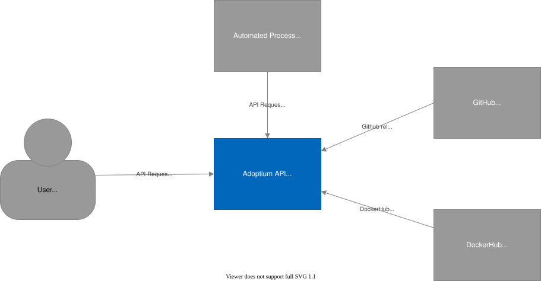
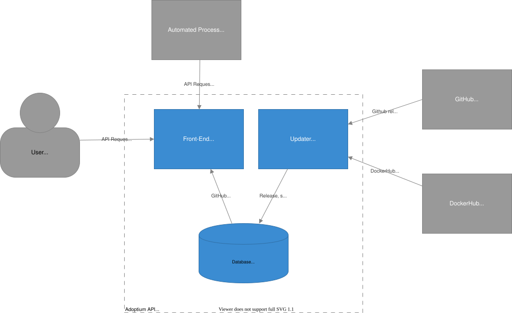

# Structure

The Adoptium API has 2 main components:

1. Updater - Pulls data from a number of sources such as Github and Docker, parses the data and stores it to the DB.
1. Front-end -  Serve up responses to web requests at <https://api.adoptium.net>.

## Architecture Diagrams

The diagrams have been created using the [C4 model](https://c4model.com/) with <http://diagrams.net/> .

### Context

### Container

## Updater

The updater periodically polls for new data, and stores that data into the DB. There are 2 types of refresh:
1. Full
    - A full refresh of all data from the various sources
    - Performed when the updater starts and then every 24 hours there-after. 
1. Incremental
    - A refresh of new or changed releases, recent releases, and the latest EA per repository and Java feature version.
    - Scheduled with a 6-minute delay after the preceding incremental execution finishes.

The replacement unit is a complete upstream GitHub release, including all API
version splits. A failed incremental EA refresh retains its previous complete
snapshot, while a full rebuild omits that failed EA rather than carrying its old
splits forward. Other releases continue updating, and failed new EAs remain
unpublished. Full builds still abort on GA failures or repository-wide release-list
retrieval/pagination failures.
Incremental discovery includes supported Java versions absent from the stored
catalogue, so omitting a version's only EA does not prevent later recovery.
See [ADR 8: release snapshot update semantics and failure isolation](adr/0008-release-snapshot-update-semantics.md)
for the [assumptions and scope](adr/0008-release-snapshot-update-semantics.md#assumptions-and-scope),
decisions, selection rules, exclusions and failure-mode table, including
a [behaviour comparison with upstream/main](adr/0008-release-snapshot-update-semantics.md#behaviour-comparison-with-upstreammain)
at the recorded baseline.
 
The sources of data for the API are:

### GitHub
The binary repositories such as:
- https://github.com/adoptium/temurin8-binaries
- https://github.com/adoptium/temurin11-binaries
- https://github.com/adoptium/temurin17-binaries

Each of these repos contains a number of releases, inside each release are a number of assets in general for each asset there is:
- Binary archive (e.g. OpenJDK17-jdk_x64_linux_hotspot_17_35.tar.gz)
- Metadata file (e.g. OpenJDK17-jdk_x64_linux_hotspot_17_35.tar.gz.json)
- Checksum (e.g. OpenJDK17-jdk_x64_linux_hotspot_17_35.tar.gz.sha256.txt)

The CycloneDX Attestation repositories such as:
- https://github.com/adoptium/temurin-cdxa

The CycloneDX Attestation repository contains CDXA Attestation xml documents that assert to the reproducible build verification of Adoptium binaries.
A cdxa repository contains the following structure:
    featureVersion/releaseTag/cdxa.xml
    featureVersion/releaseTag/cdxa.xml.sig

The updater interacts with the GitHub API using the [V4 GraphQL interface](https://developer.github.com/v4/guides/intro-to-graphql/).
Once we have obtained the data through the GitHub API the Upstream (for the upstream OpenJDK project) and Adoptium mappers which map the
GitHub data into Adoptium API models.
It does this by iterating through the list of repos and releases, for each binary asset download its metadata or checksum and parse their contents in order to extract the data.
Genuinely metadata-free legacy releases fall back to release-name and filename parsing.
When a release uses metadata, missing required sidecars or failed binary mappings
reject that upstream snapshot rather than publishing the remaining binaries.
Checksum disagreements are an explicit exception: log an error and omit only the
binary whose GitHub SHA-256 conflicts with metadata or a checksum sidecar. An
installer disagreement omits only the installer. Installer metadata assets are
also read for checksum verification, without making them a prerequisite for
mapping the associated archive.
CycloneDX Attestation resources are also iterated through by querying using GitHub GraphQL queries on the "Cdxa github repositories".

In order to speed up access and reduce bandwidth we use Mongo as a cache for this data.
Metadata and checksum assets use cache keys containing their URL and available
GitHub asset identity/digest. Replaced assets are fetched on demand; assets without
identity information are fetched rather than trusted from a URL-only cache.
Other URL-cached resources can still be refreshed asynchronously. Entries expire
after 30 days without demand access; background validation does not extend retention.

### DockerHub
The DockerHub repositories are only required for displaying stats.
We pull data from the DockerHub API inside DockerStatsInterface.

### Running
To run the updater tool:
 - generate the artifacts by running `mvnw clean install`. 
 - `cd` into the `adoptium-api-v3-updater` directory
 - run `java -jar ./target/adoptium-api-v3-updater-3.0.0-SNAPSHOT-jar-with-dependencies.jar`

### Database
The database stores 4 main types of data:
1. Release - The raw binary data extracted from GitHub
1. Stats - Download statistics. Updated at the end of a full refresh.
    - DockerStats - Broken down into each docker repository
    - GitHubStats - Broken down into each feature version
1. Web-Cache - Cached data used to speed up requests
1. Cdxa - The reproducible build CycloneDX Attestation (CDXA)

## Front-end

The front-end is a Quarkus application that uses OpenAPI for documentation.
Data is polled from the database into memory and requests are then serviced from that dataset.

### Examples

A full list of endpoints and each of the parameters can be found at <https://api.adoptium.net/swagger-ui/>

### Running
To run the front-end quarkus tool, `cd` into the `adoptium-api-v3-frontend` directory and run `../../mvnw quarkus:dev -Padoptium`. This will then run the tool on port 8080.
NOTE: You will need to have let the Updater run a full cycle before any data is shown.
